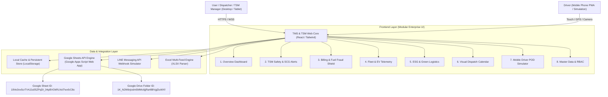

# 📋 Master Architecture & Implementation Plan: TTMK TMS & TSM Safety Platform
**หจก.ทั่วไทยขนส่งมงคล (Thua Thai Khonsong Mongkhon TMS & TSM Safety Platform)**  
*Enterprise-Grade Logistics & Transport Safety Management System*  
*Lead Architect & UI/UX Specialist: Taweesak K. (062-3285963)*  

---

## 🏛️ 1. ภาพรวมสถาปัตยกรรมระบบ (Executive System Architecture)

ระบบถูกออกแบบภายใต้มาตรฐาน **Enterprise Logistics Platform** เพื่อรองรับการบริหารจัดการกองรถ 6 ล้อ (ทั้งเครื่องยนต์ดีเซล และรถบรรทุกไฟฟ้า EV 100%) การควบคุมความปลอดภัยตามมาตรฐานกรมการขนส่งทางบก (TSM) และข้อกำหนดของเครือ SCG พร้อมระบบตรวจสอบป้องกันการทุจริตค่าน้ำมัน และระบบกระจายสินค้าพร้อมหลักฐานการส่งมอบดิจิทัล (Proof of Delivery - POD)



---

## 💻 2. TECH STACK & DESIGN SYSTEM

| หมวดหมู่ | เทคโนโลยีที่เลือกใช้ | รายละเอียดและการนำไปใช้งาน |
| :--- | :--- | :--- |
| **Frontend Framework** | **React Modular Architecture** (Single Page Application / Vite Component Structure) | โครงสร้าง Component-Driven แยกไฟล์เป็นอิสระ ดูแลรักษาง่าย ประสิทธิภาพสูง 60fps |
| **Styling & Theme** | **Tailwind CSS v3.4+** | โทนสี Enterprise Logistics:<br>• **Dark Navy:** `#0F172A`, `#1E293B`<br>• **Brand Blue:** `#1E40AF` (Royal Deep Blue)<br>• **Logistics Orange:** `#EA580C` / `#F97316` (Active Dispatch)<br>• **White Slate:** `#F8FAFC`, `#FFFFFF`<br>• **Safety Green & Alert Red:** `#10B981` / `#EF4444`<br>• **EV Cyan:** `#06B6D4` |
| **Theme Engine** | **Dual Dark / Light Mode** | รองรับการสลับโหมดทันที บันทึกสถานะลง LocalStorage คอนทราสต์ตัวอักษร 100% คมชัด |
| **Iconography** | **Lucide Icons** | ไอคอนสไตล์ Modern Minimalist ชัดเจน อ่านง่าย |
| **Visualization & Charts** | **Chart.js + Canvas API Engine** | กราฟแนวโน้มรายได้ (Line & Bar), กราฟสัดส่วนงาน (Donut Chart), มาตรวัดคะแนนความปลอดภัย (Radial Gauge) |
| **Mapping Engine** | **Leaflet.js + OpenStreetMap Thailand** | Live GPS Vehicle Tracking แสดงพิกัดรถ ตำแหน่งวิ่ง/จอด และเส้นทางเดินรถ |
| **Data Persistence** | **Hybrid Architecture** | 1. Google Sheets API (Google Apps Script Web App ID: `19Ve3nx5...`)<br>2. LocalStorage Persistence ป้องกันข้อมูลหายเมื่อรีเฟรช<br>3. Offline Mockup Fallback เมื่อไม่มีอินเทอร์เน็ต |
| **External Integration** | **LINE Webhook & File Parser** | • จำลองการยิง Webhook แจ้งเตือนเข้า LINE กลุ่มคนขับ/ผู้บริหาร<br>• SheetJS (XLSX) รองรับไฟล์ตัวอย่างตั้งเบิก 15 รูปแบบใน `C:\TTMK\File` |
| **Document Engine** | **Official A4 Print Layout** | แม่แบบใบเสร็จ, ใบเสนอราคา, ใบวางบิล, ใบเบิกค่าน้ำมัน พร้อมหัวกระดาษ "หจก.ทั่วไทยขนส่งมงคล" และช่องลงนามมาตรฐาน |

---

## 🗂️ 3. โครงสร้างไฟล์และโฟลเดอร์ (Folder & Module Structure)

```text
c:\TTMK\
├── File\                              # ตัวอย่างไฟล์ Excel 15 Feed จริง
│   ├── ทั่วไทยขนส่งมงคล 1-15 กย.69.xlsx
│   ├── 09 TCCB ค่าขนส่งต่อตัน...xlsx
│   └── ...
├── src\                               # โครงสร้าง Source Code แยกส่วนมาตรฐาน
│   ├── assets\                        # โลโก้, รูปภาพ, ไอคอนแบรนด์
│   ├── components\                    # UI Components ส่วนกลาง
│   │   ├── Navbar.jsx                 # แถบบน: แสดงสถานะ GPS, Sheet Status, Theme Toggle, User
│   │   ├── Sidebar.jsx                # เมนูด้านข้าง Collapsible 8 เมนู + Credit Bar ด้านล่าง
│   │   ├── CreditBar.jsx              # Tab Credit: DevBy.Taweesak.kom (062-3285963)
│   │   ├── KPIBox.jsx                 # การ์ดแสดงผลสถิติ High-Contrast
│   │   └── ModalContainer.jsx         # Modal Popup แบบ Glassmorphism
│   ├── modules\                       # 8 เมนูหลักแยกตาม Business Domain
│   │   ├── 01_Overview\               # 1. ภาพรวมระบบ (Overview Dashboard & Live Map)
│   │   ├── 02_TSMSafety\              # 2. SCG Alerts & Pre-trip Checklist
│   │   ├── 03_BillingFuel\            # 3. ตั้งเบิก, คำนวณอัตราสิ้นเปลือง & Fraud Detection
│   │   ├── 04_FleetEV\                # 4. ทะเบียนรถ 6 ล้อ ดีเซล & EV Telemetry
│   │   ├── 05_ESG\                    # 5. การจัดการพลังงานและ ESG Carbon Calculator
│   │   ├── 06_DispatchCalendar\       # 6. ปฏิทินจัดคิวรถ (Visual Gantt Calendar)
│   │   ├── 07_DriverPOD\              # 7. Mobile Driver POD Simulator (Camera, GPS, Signature)
│   │   └── 08_MasterData\             # 8. ข้อมูลตั้งต้น, ผู้ใช้งาน & RBAC
│   ├── services\                      # ชั้นเชื่อมต่อ Data Layer
│   │   ├── googleSheetService.js      # ดึงและส่งข้อมูล Google Apps Script
│   │   ├── excelParserService.js      # สกัดข้อมูล Excel ทุก Feed
│   │   ├── lineWebhookService.js      # จำลองยิง Alert เข้า LINE
│   │   └── fuelCalculator.js          # อัลกอริทึมคำนวณ กม./ลิตร และตรวจจับทุจริต
│   └── utils\                         # ฟังก์ชันอรรถประโยชน์ (Format Date, Number, Currency)
├── index.html                         # ไฟล์หลัก Single-File Production Ready (Synced)
├── control_center_dashboard.html      # Development Master Template
├── google_apps_script.gs              # โค้ด Apps Script ฝั่ง Google Sheets
└── tasks.md                           # แผนการดำเนินงานฉบับละเอียด
```

---

## 🎯 4. รายละเอียดฟังก์ชันทั้ง 8 เมนูหลัก (Core Modules Specification)

### 📊 [เมนูที่ 1] ภาพรวมระบบ (Overview Dashboard)
- **KPI Cards High-Contrast:**
  - งานรอจัดส่ง (Pending Jobs), กำลังขนส่ง (In-Transit), ส่งมอบสำเร็จ (Delivered)
  - รายได้รวมประจำเดือน (Gross Revenue)
  - อัตราการส่งมอบตรงเวลา (On-Time Delivery Rate: เป้าหมาย > 98%)
  - อัตราสิ้นเปลืองน้ำมันเฉลี่ยทั้งฝูงรถ (Fleet Average Fuel Efficiency: กม./ลิตร)
- **Revenue & Jobs Trend Chart:** กราฟผสม Line & Bar Chart แสดงแนวโน้มรอบ 30 วัน
- **Job Status Donut Chart:** สัดส่วนสถานะงาน (บรรจุแล้ว, จ่ายงานแล้ว, กำลังส่ง, ส่งสำเร็จ)
- **Live Vehicle Map & Telemetry Widget:** แผนที่ Leaflet แสดงตำแหน่งรถวิ่งจริง (รถดีเซลไอคอนน้ำเงิน, รถ EV ไอคอนเขียว) พร้อมความเร็วแบบเรียลไทม์

### 🛡️ [เมนูที่ 2] SCG Alerts & ศูนย์ควบคุมความปลอดภัย TSM (TSM Safety Oversight)
- **Pre-trip Inspection Checklist:** แบบฟอร์มตรวจสภาพรถ 10 จุดก่อนออกปฏิบัติงาน:
  - ค่าแอลกอฮอล์เป่าเป็น 0 มก.% (Digital Breathalyzer Check)
  - แรงดันลมยางและสภาพดอกยาง
  - ประสิทธิภาพระบบเบรก
  - กล้อง AI DMS/ADAS หน้ารถทำงานปกติ
  - ความถูกต้องของใบขับขี่ประเภท ท.2 / ท.3
- **Driver Rest & Driving Hours Monitor:** ตรวจสอบชั่วโมงขับขี่ต่อเนื่องไม่เกิน 4 ชม. ต้องพัก 30 นาที และไม่เกิน 8 ชม./วัน ตามกฎหมายกรมการขนส่งทางบกและข้อกำหนด SCG
- **SCG Safety Incident Feeds:** กล่องเตือนเหตุการณ์ฉุกเฉิน (ความเร็วเกิน 60 กม./ชม. ในเขตชุมชน, 80 กม./ชม. ทางหลวง, การเบรกกะทันหัน, ขับออกนอกเส้นทาง Geofence) พร้อมปุ่มบันทึกการติดต่อคนขับ

### 💰 [เมนูที่ 3] ตั้งเบิก / รายได้วิ่งรถ & ควบคุมค่าน้ำมัน (Cost & Billing Management)
- **Excel Multi-Feed Smart Parser:** รองรับการอัปโหลดไฟล์ Excel ตั้งเบิกทั้ง 15 รูปแบบใน `C:\TTMK\File` (P-Pack, TCCB/TCRY/TCKP, SCG Packaging, ขนส่งสารเคมี, EV Fleet, ผรม.วางบิล, ผรม.พาเลท)
- **Fuel Fraud Detection Shield (ระบบตรวจจับทุจริตค่าน้ำมัน):**
  - สูตรคำนวณ: `อัตราสิ้นเปลือง = ระยะทางไมล์ GPS จริง (กม.) ÷ ปริมาณน้ำมันที่เติม (ลิตร)`
  - เกณฑ์มาตรฐานรถ 6 ล้อบรรทุกหนัก: `5.0 - 6.5 กม./ลิตร`
  - หากระบบตรวจพบค่าต่ำกว่า `4.2 กม./ลิตร` ระบบจะขึ้น **Fraud Warning Alert** (ต้องสงสัยว่ามีการดูดน้ำมันหรือแจ้งยอดบิลเกินจริง)
- **Official A4 Export & Print Engine:**
  - ออกเอกสารมาตรฐานบริษัท 4 แบบ:
    1. **ใบวางบิลค่าขนส่ง (Billing Note)** - แยกตาม Feed และลูกค้ารายงวด (1-15, 16-31)
    2. **ใบสรุปสั่งจ่ายค่าเที่ยว (Disbursement Voucher)** - แยกตามทะเบียนรถและคนขับ
    3. **ใบเบิกค่าน้ำมันเชื้อเพลิง (Fuel Requisition Voucher)** - แสดงเลขไมล์และอัตราสิ้นเปลือง
    4. **ใบเสร็จรับเงิน / ใบเสนอราคา (Receipt / Quotation)**
  - มีหัวกระดาษตรา "หจก.ทั่วไทยขนส่งมงคล", เลขประจำตัวผู้เสียภาษี, ตารางสรุป VAT 7%, หัก ณ ที่จ่าย 1% และช่องลงนามอนุมัติทำจ่าย

### 🚛 [เมนูที่ 4] จัดการยานพาหนะ & รถ 6 ล้อ ดีเซล / EV (Fleet & Maintenance)
- **Fleet Database:** บันทึกประวัติรถทุกคันในกองทัพ (ทะเบียน 70-1234, 71-9988, 72-5566, 74-5284 ฯลฯ)
- **Legal & Compliance Timeline:** แจ้งเตือนวันหมดอายุภาษีป้ายทะเบียน, พ.ร.บ., ประกันภัยสินค้า และรอบตรวจสภาพ ตรอ.
- **Maintenance Lifecycle:** กำหนดรอบตรวจเช็กระยะ (PM) ทุก 10,000 กม. พร้อมประวัติเปลี่ยนถ่ายของเหลว สลับยาง
- **EV Truck Telemetry (เฉพาะรถไฟฟ้า 100%):**
  - ระดับแบตเตอรี่ (State of Charge - SoC %)
  - อัตราการใช้พลังงานไฟฟ้าเฉลี่ย (kWh/km)
  - สถานะการชาร์จ (Charging / Ready / Discharging)

### 🌿 [เมนูที่ 5] การจัดการพลังงานและ ESG (ESG & Green Logistics)
- **Carbon Footprint Calculator:** คำนวณการปล่อยก๊าซเรือนกระจก:
  - ดีเซล: `~2.68 kg CO2e / ลิตร`
  - EV (ไทย Grid Emission Factor): `~0.4999 kg CO2e / kWh`
  - สรุปตัวเลข **"ลดการปล่อยก๊าซคาร์บอนไดออกไซด์ได้แล้วกี่ตัน CO2e"** จากการใช้รถ EV
- **SCG Green Supply Chain Scorecard:** รายงานคะแนนด้านสิ่งแวดล้อม (ESG) สำหรับส่งมอบให้คู่ค้าระดับองค์กร

### 📅 [เมนูที่ 6] ปฏิทินจัดคิวรถ (Visual Dispatch Calendar)
- **Interactive Visual Calendar / Gantt Chart:**
  - แถบแสดงสถานะงานของรถแต่ละคันตลอดทั้งสัปดาห์ / เดือน
  - ป้องกันปัญหารถจอดนิ่งโดยเปล่าประโยชน์ (Zero Empty Running)
- **Smart Dispatch Matching:** ฟังก์ชันจับคู่ พนักงานขับรถ + รถบรรทุก + เส้นทาง และจุดรับส่ง

### 📱 [เมนูที่ 7] Mobile Driver App Simulator (ระบบ POD สำหรับคนขับ)
- **Mobile Device Frame Simulator (หน้าจอมือถือคนขับ):**
  - **Daily Job Task:** แสดงงานประจำวัน, ชื่อลูกค้า, จุดรับสินค้า, จุดส่งสินค้าหลายจุด (Multi-drop)
  - **Camera Proof:** ถ่ายภาพสินค้าตอนขึ้นของ และถ่ายภาพสินค้าหน้าโรงงานปลายทาง
  - **Geo-Stamp:** ดึงพิกัด GPS อัตโนมัติ (Latitude, Longitude) พร้อม Timestamp วินาทีที่ส่งมอบ
  - **Digital Touch Signature Pad:** กระดานสำหรับให้ลูกค้าผู้รับสินค้าใช้นิ้วเซ็นชื่อรับของจริงบนหน้าจอ
  - **Delivered Submission:** กดบันทึกแล้วระบบอัปเดตสถานะงานในแดชบอร์ดหลักเป็น "ส่งสำเร็จ" ทันที

### ⚙️ [เมนูที่ 8] ข้อมูลตั้งต้นและผู้ใช้งาน (Master Data & TSM Settings)
- **Master Lists:** จัดการรายชื่อลูกค้า, เส้นทางขนส่ง, อัตราค่าบริการตามระยะทาง, ข้อมูลพนักงานขับรถ
- **Role-Based Access Control (RBAC):**
  - `Super Admin:` สิทธิ์สูงสุด จัดการระบบ บัญชี และความปลอดภัย
  - `TSM / Dispatcher:` จัดคิวรถ, ตรวจความปลอดภัย, จัดการ SCG Alerts
  - `Accountant:` ดูแลการตั้งเบิก, ค่าน้ำมัน, ออกใบวางบิล
  - `Driver:` เข้าถึงเฉพาะส่วนงาน Mobile POD Simulator

---

## 📅 5. ตารางงานและลำดับขั้นตอนการพัฒนา (Task List & Implementation Steps)

- [x] **Step 1: วางแผน Implementation Plan ใน `tasks.md` และสร้าง Architecture Baseline**
  - [x] วิเคราะห์ Requirement ทั้งหมด 8 โมดูลและจัดทำ Master Document
  - [x] จัดเตรียมโครงสร้างไฟล์และ State Management Strategy
  - [x] นำเสนอแผนให้ผู้ว่าจ้างตรวจอนุมัติก่อนเริ่มเขียนโค้ด (อนุมัติเรียบร้อย)

- [x] **Step 2: จัดทำ Global Theme & Layout Shell (Navigation & Core Components)**
  - [x] สร้าง Topbar พร้อมปุ่มสลับ Dark/Light Mode, ตัวบอกสถานะ GPS & Google Sheets
  - [x] สร้าง Sidebar แบบ Collapsible รองรับทั้ง 8 เมนู 60fps
  - [x] ติดตั้ง Credit Tab ด้านล่าง: `DevBy.Taweesak.kom (062-3285963)` พร้อม Credit Modal
  - [x] จัดทำ Responsive Breakpoints รองรับ Desktop, iPad/Tablet, และมือถือคนขับ

- [x] **Step 3: พัฒนาระบบภาพรวม [เมนู 1: Overview Dashboard]**
  - [x] ติดตั้ง Stats Cards ไฮคอนทราสต์ (งานรอส่ง, รายได้, On-time, อัตรากินน้ำมัน)
  - [x] วาดกราฟแนวโน้มรายได้ (Line & Bar Chart) ด้วย Chart.js
  - [x] วาด Donut Chart สัดส่วนสถานะงาน
  - [x] ฝัง Interactive Map (Leaflet.js) แสดงตำแหน่งรถแบบ Live พร้อมไอคอนหมวดหมู่

- [x] **Step 4: พัฒนาระบบ TSM Safety & SCG Alerts [เมนู 2: TSM Safety Oversight]**
  - [x] สร้างแบบฟอร์มตรวจสอบรถ 10 จุด (Pre-trip Inspection) พร้อมวัดแอลกอฮอล์ 0 มก.%
  - [x] สร้างหน้าต่างบันทึกและมอนิเตอร์ชั่วโมงขับขี่ของคนขับ (เตือนพักรถหลังขับ 4 ชม.)
  - [x] สร้าง Feed แจ้งเตือนเหตุการณ์ฉุกเฉิน (ความเร็วเกิน, เบรกกะทันหัน) พร้อมปุ่มตอบกลับ

- [x] **Step 5: พัฒนาระบบตั้งเบิก ค่าน้ำมัน และพิมพ์เอกสาร A4 [เมนู 3: Cost & Billing]**
  - [x] ผสานระบบอ่านไฟล์ Excel ทั้ง 15 Feed พร้อม Auto-detect ด้วย SheetJS
  - [x] พัฒนาระบบคำนวณ กม./ลิตร และตรวจจับความผิดปกติค่าน้ำมัน (Fuel Fraud Shield)
  - [x] สร้างระบบพิมพ์เอกสาร A4 สวยงาม: ใบวางบิล, ใบสรุปค่าเที่ยว, ใบเบิกน้ำมัน พร้อมช่องลงนาม 3 ฝ่าย
  - [x] เพิ่ม Tailwind `@media print` ซ่อน Navbar/Sidebar และจัด Layout กล่องบิลสัดส่วน A4 คมชัดพร้อมคีย์ลัด Ctrl+P

- [x] **Step 6: พัฒนาระบบ Fleet EV/Diesel [เมนู 4] และ ESG Carbon Tracker [เมนู 5]**
  - [x] สร้างตารางข้อมูลยานพาหนะ พร้อมมาตรวัดแบตเตอรี่และอัตรากินไฟรถ EV
  - [x] สร้างโมดูลคำนวณ Carbon Footprint ลดการปล่อย CO2e เทียบดีเซลกับไฟฟ้า

- [x] **Step 7: พัฒนาปฏิทินจัดคิวรถ [เมนู 6] และ Mobile Driver POD Simulator [เมนู 7]**
  - [x] สร้าง Gantt/Calendar View สำหรับจัดคิวงานรถ
  - [x] จำลอง Mobile Driver App: ถ่ายรูปสินค้า, บันทึก GPS, กระดานเซ็นชื่อดิจิทัล (Signature Pad แบบวาดจริง)

- [x] **Step 8: พัฒนาระบบ Master Data & RBAC [เมนู 8] และ Data Layer Integration**
  - [x] จัดการระบบสิทธิ์ผู้ใช้งาน 4 ระดับ (Admin, TSM, บัญชี, ผขร.)
  - [x] เชื่อมโยง Data Layer (Google Sheets API Web App + LocalStorage Cache)
  - [x] ทดสอบระบบจำลองส่ง Webhook เข้า LINE Messaging API

- [x] **Step 9: ทดสอบภาพรวมและตรวจสอบความประณีต (Quality Assurance)**
  - [x] ทดสอบ Responsive บนทุกขนาดหน้าจอ
  - [x] ตรวจสอบความถูกต้องของไวยากรณ์ JavaScript ผ่าน Node VM (0 Errors)
  - [x] ตรวจสอบความสมบูรณ์ของไฟล์ index.html และ control_center_dashboard.html (100% Synced)
  - [x] ส่งมอบงานและสรุปผล Walkthrough

- [x] **Step 10: บูรณาการระบบนิเวศ (Ecosystem Integration) & มาตรฐานธีม Cockpit HUD เดียวกัน**
  - [x] สำรองและ Commit งานเดิมใน Sub-repos ทั้งหมด (`Alcohol` และ `CheckTruck`) ให้ Working Tree สะอาด 100%
  - [x] ปรับ Brand Identity & Topbar/Sidebar ของ Dashboard ให้เป็นมาตรฐานเดียวกัน (TTMK Gold Badge, Gradient Cyan/Amber, Cockpit HUD Glass)
  - [x] ติดตั้ง Quick App Switcher เปิดสลับไปยังแอปเป่าแอลกอฮอล์, ตรวจรถ 6 ล้อ 3D และลงทะเบียนคนขับ
  - [x] เชื่อมโยงข้อมูลสด (Live Feeds) เข้าสู่ [เมนู 2: TSM Safety Oversight]:
    - ผลตรวจแอลกอฮอล์สด (Zero Tolerance 0.00 mg%) + หน้าต่างดูรูปคู่ (ใบหน้า + หน้าปัดเครื่องเป่า)
    - ผลตรวจสภาพรถ 6 ล้อ ดีเซล & EV (26 จุดมาตรฐาน SCG JWD) + ระบบสร้างรายงานสรุป PDF รายวันและรายเดือนแนวนอน
  - [x] ซ่อมแซมไวยากรณ์ใน `google_apps_script.gs` และซิงค์ `index.html` <-> `control_center_dashboard.html` เรียบร้อย

